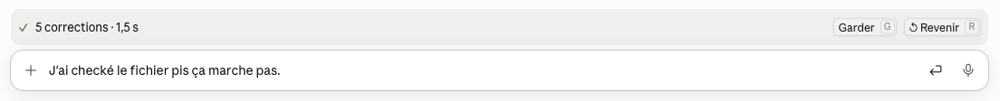
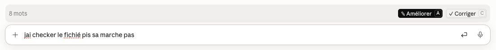

# MyConfig Lite

Mod Claude Code qui améliore ta demande en prompt clair ou corrige ton texte, d'un clic, juste
au-dessus du champ de saisie. C'est le module Correction de [MyConfig](https://github.com/mdany75/myconfig),
repris seul et refait de zéro : nouvelles consignes, évaluées sur de vraies dictées, et une bande
plus discrète.





## Fonctions

- **La bande n'apparaît que si le champ a du texte** : le nombre de mots à gauche, puis
  « ✎ Améliorer » et « ✓ Corriger ». Champ vide : rien ne s'affiche. Au terminal, elle suit chaque
  frappe ; l'app de bureau ne transmet pas les frappes aux mods, et la bande y apparaît quelques
  secondes après le début de la saisie.
- **✎ Améliorer** réécrit ta demande, souvent dictée, en un prompt que Claude Code comprend du
  premier coup : l'oral nettoyé (hésitations, reprises), les faits, chiffres, contraintes et
  chemins gardés mot pour mot, rien d'inventé, une structure seulement quand elle aide.
- **✓ Corriger** corrige seulement les fautes (orthographe, accords, accents, ponctuation, mots mal
  reconnus par la dictée) et garde tes mots, ton ton et tes québécismes.
- **Pendant le travail** : « Reformulation… · Sonnet » ou « Correction… · Opus », et **Annuler**.
- **Après** : un bilan, puis **Garder** ou **↺ Revenir** à ton texte. Pour ✓ Corriger, il liste les
  mots corrigés (« 5 corrections · 1,5 s · J'ai checké, fichier, ça ») ; pour ✎ Améliorer, il compte
  les mots (« Prompt amélioré · 19 → 18 mots · 1,8 s »). Au terminal, les mots corrigés sont aussi
  surlignés dans le champ ; l'app de bureau ne dessine pas encore ce surlignage. Une frappe ou
  l'envoi retire le bilan.
- Au clavier, une fois la bande sélectionnée (un clic, ou ctrl+x puis Tab) : `a` Améliorer,
  `c` Corriger, `g` Garder, `r` Revenir.
- **`/lite`** montre les réglages, gardés d'une session à l'autre :
  - `/lite modele haiku | sonnet | opus` : le modèle des deux boutons ;
  - `/lite ameliorer <modèle>`, `/lite corriger <modèle>` : le modèle d'un seul bouton ;
  - `/lite surlignage on | off` : surligner ou non les mots corrigés.

Par défaut, ✎ Améliorer utilise Sonnet et ✓ Corriger, Opus : sur 20 dictées réelles et difficiles,
Opus n'a laissé aucune faute grave, Sonnet une ou deux, Haiku six. Pour une correction plus rapide :
`/lite corriger sonnet`.

## Installer

Dans une session Claude Code au terminal :

```
/plugin install myconfig-lite --marketplace mdany75/MyConfig-Lite
```

Réponds `y` pour ajouter le marketplace, puis choisis la portée (Entrée : pour toi, dans tous tes
projets). Depuis un shell :

```bash
claude plugin install myconfig-lite --marketplace mdany75/MyConfig-Lite
```

Dans l'app de bureau, où `/plugin` ne s'ouvre pas : + à côté du champ de saisie, puis Plugins,
« Add marketplace » avec `mdany75/MyConfig-Lite`, puis « Add plugin ». Le mod installé au
terminal se charge aussi dans l'app de bureau.

Configuration requise : Claude Code 2.1.295 ou plus récent. Les appels au modèle passent par ta
session Claude Code (ton forfait ou ta clé), sans réglage de plus.

Ne garde pas en même temps l'ancien MyConfig : sa Correction ferait double emploi.

## Tests

```bash
claude plugin validate . && claude plugin test .
```

## Organisation

- `.claude-plugin/plugin.json` : manifeste du mod
- `.claude-plugin/marketplace.json` : le dépôt comme marketplace `myconfig-lite`
- `hooks/register.tsx` : les hooks, la bande et la commande `/lite`
- `hooks/correction.ts` : fonctions pures (réponse du modèle, différences, bilan, réglages)
- `hooks/consignes.ts` : les consignes système des deux boutons
- `types/index.d.ts` : contrat des valeurs gardées dans `$.state`
- `tests/` : tests du mod
- `docs/` : captures d'écran

## Licence

MIT, voir [LICENSE](LICENSE).
